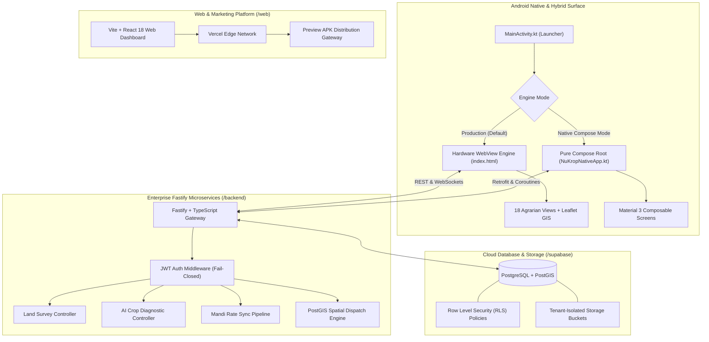

<div align="center">
  
  <h1>NuKropAI Enterprise</h1>
  <p><strong>The Enterprise Agrarian Intelligence & Logistics Operating System for Indian Agriculture</strong></p>
  <p>
    <a href="https://github.com/B-JASWANTH-REDDY/NuKropAI/blob/main/LICENSE">
      
    </a>
    <a href="https://react.dev">
      
    </a>
    <a href="https://developer.android.com/kotlin">
      
    </a>
    <a href="https://fastify.dev">
      
    </a>
    <a href="https://supabase.com">
      
    </a>
    <a href="https://groq.com">
      
    </a>
  </p>
</div>

<hr />

## 🌾 Overview

**NuKropAI** is a high-availability, full-stack agrarian operating system engineered to empower smallholder Indian farmers with computer-vision crop diagnostics, live Agmarknet mandi price discovery, on-demand freight logistics (GramHaul), and financial ledger bookkeeping (Farm Khata).

Built with enterprise-grade resilience, the platform combines a hardware-accelerated mobile engine with a fail-closed Fastify microservices backend, offline-first edge caching (SWR), and strict DPDP Act privacy safeguards.

---

## 🏛️ Multi-Surface Architecture



### 📱 1. Android Application (`/app`)
- **Dual-Engine Flexibility**: Runs an authoritative production engine ([`app/src/main/assets/index.html`](app/src/main/assets/index.html)) with 100% byte-for-byte browser parity ([`nukrop_emulator.html`](nukrop_emulator.html)), alongside a 100% Pure Native Jetpack Compose container ([`NuKropNativeApp.kt`](app/src/main/java/com/example/NuKropNativeApp.kt)).
- **Foreground Tracking**: Android Foreground Service (`DriverLocationService.kt`) with native GPS telemetry and notification channels.
- **Native TTS**: Multilingual speech synthesis configured with natural Indian female voices across English (`en-IN`), Hindi (`hi-IN`), and Telugu (`te-IN`).

### ⚙️ 2. Enterprise Backend (`/backend`)
- **Fastify + TypeScript**: High-throughput REST API with schema validation, rate limiting, and structured logging.
- **Fail-Closed Security**: Zero hardcoded secrets, cryptographic JWT verification with issuer and audience enforcement, and role-based access control (`requireRole`).
- **Resilient Fallback**: Automatic failover to state-preserving in-memory caches during database disconnects.

### 🗄️ 3. Database & Spatial Cloud (`/supabase`)
- **PostgreSQL 15 + PostGIS**: Geospatial indexing for driver proximity matchmaking, mandi geofences, and parcel boundary mapping.
- **Row Level Security**: 100% table coverage with strict multi-tenant isolation protecting farmer and driver data.

### 🌐 4. Web Dashboard & Distribution (`/web`)
- **React 18 + Vite**: Responsive web interface with DPDP compliance modals, Command Menu (`Ctrl+K`), and automated APK distribution sync.

---

## 🌟 The 18 Canonical Agrarian Views

| # | View Key | Purpose | Key Capabilities |
| :---: | :--- | :--- | :--- |
| **1** | `home` | Farmer Command Center | Real-time weather, nearest in-state APMC mandi rates, active crop carousel. |
| **2** | `scanner` | AI Foliar & Soil Doctor | Step 1 non-plant rejection, ICAR botanical diagnosis, CIB&RC chemical dosages. |
| **3** | `market` | Mandi Price Discovery | Daily Agmarknet prices, 30-day SVG price trend curves, state-level fallback. |
| **4** | `community` | Kisan Social Network | Farmer queries, verified agronomist answers, media attachments, 0 duplicate posts. |
| **5** | `profile` | Farmer Passport & Identity | Multi-account persistence, language selection, AgriStack land record integration. |
| **6** | `farm_khata` | Digital Bookkeeping Ledger | Income/expense tracking, optimistic entry deletion with Undo Toast, net margin charts. |
| **7** | `biorx` | Bio-Formulation Lab | Vedic formulations (Jeevamrutha, Neem oil), acreage tank mix calculators. |
| **8** | `equipment_rental` | Machinery Sharing | Tractors, rotavators, sprayers, peer-to-peer owner matchmaking with tap-to-call. |
| **9** | `tractor_autopilot` | Field Waypoint Navigation | GPS heading angle, route guidance, speed telemetry, field perimeter mapping. |
| **10** | `mandi_pilot` | Multi-Market Arbitrage | Real-time price comparisons across regional APMCs to maximize crop sale profits. |
| **11** | `gramhaul` | Agrarian Freight Dispatch | Distance-based fare calculation, driver discovery, 4-digit OTP trip authorization. |
| **12** | `driver_dashboard` | Hauler Operations Cockpit | Standby map pin sync, offline/online duty toggle, live turn-by-turn navigation. |
| **13** | `agristack_passport` | Digital Land Identity | RoR 1B / Pahani / 7/12 land document parser with DPDP explicit consent. |
| **14** | `yantra_share` | Custom Hiring Center | Government CHC machinery booking and seasonal implements reservation. |
| **15** | `saved_reports` | Offline Diagnostic Archive | Historical disease scans, soil reports, and exportable PDF advisories. |
| **16** | `calculators` | Agronomic Utilities | Fertilizer N-P-K calculator, seed rate estimator, plant population density. |
| **17** | `peer_chat` | Real-Time Messaging | Direct farmer-to-farmer and driver-to-farmer communication. |
| **18** | `bioshield_radar` | Regional Outbreak Radar | Hyperlocal pest density heatmaps and early warning broadcast ribbons. |

---

## 🧪 Verification & Quality Engineering

NuKropAI enforces a strict zero-regression testing protocol. Every commit must pass all test suites before deployment:

```bash
# 1. Mandatory End-to-End User Journeys (8/8 Journeys)
node tests/test_mandatory_user_journeys.js

# 2. Permanent Mobile Engineering Standards (40/40 Standards)
node tests/test_mobile_permanent_standards.js

# 3. Comprehensive E2E Test Runner (208/208 Tests)
node tests/run_e2e_tests.js

# 4. Enterprise Backend Security & Controller Suite (49/49 Tests)
npm --prefix backend test

# 5. Production Simulation & DB Target Safety Guards (15/15 Tests)
python -m unittest tests/test_simulation_safety_guards.py

# 6. Android Unit Tests
.\gradlew testDebugUnitTest

# 7. Web Production Build
npm --prefix web run build
```

---

## 🛠️ Local Development & Build Guide

### Prerequisites
- **Android Studio** Ladybug or newer with embedded JBR (JDK 17)
- **Node.js** 18 LTS or newer & npm
- **Python** 3.10+ (for simulation safety guards and ETL verification)

### 1. Build Android Debug APK
```powershell
$env:JAVA_HOME = "C:\Program Files\Android\Android Studio\jbr"
.\gradlew assembleDebug testDebugUnitTest
```
Compiled APK: `app/build/outputs/apk/debug/app-debug.apk` (automatically synced to `NuKropAI-debug.apk`).

### 2. Run Backend API Server
```bash
cd backend
npm install
npm run dev
```

### 3. Run Web Marketing Portal
```bash
cd web
npm install
npm run dev
```
Navigate to `http://localhost:5173`.

---

## 📚 Documentation Portal

For exhaustive architectural blueprints, security audits, and domain runbooks, visit the [**Master Engineering Documentation Portal**](docs/README.md).

---

## 📜 License

Licensed under the **MIT License**. See [LICENSE](LICENSE) for details.

> **Copyright (c) 2026 B. JASWANTH REDDY**
