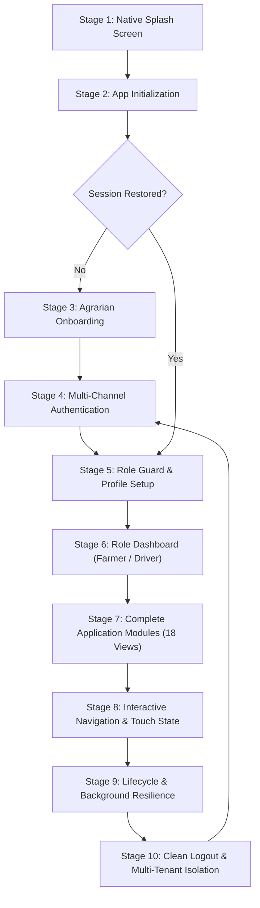

# NuKropAI — Master Application Lifecycle & Flow Specification

**Project:** NuKropAI — Agricultural Operating System  
**Document ID:** `DOC-FLOW-001`  
**Classification:** Core Engineering Specification (Permanent Architecture Rule)  
**Status:** Canonical & Active  
**Last Updated:** November 4, 2026  

---

## 1. Core Principle: Zero-Regression & Flow Preservation

NuKropAI is an integrated agricultural operating system serving Indian farmers and rural logistics haulers. It is not an arbitrary collection of isolated screens. 

### Permanent Non-Negotiable Rule
1. **Never break existing user journeys** to deliver a new screen or sub-feature.
2. **Every screen transition, API call, and state mutation** must respect the 10-stage lifecycle below.
3. Any code change that introduces blank screens, skipped onboarding steps, or broken back navigation is a **critical release blocker**.

---

## 2. The 10 Lifecycle Stages

### Stage 1 — Native Splash Screen
- **Visuals**: Centered NuKropAI SVG leaf crest, laser scanner bar animation, and agrarian telemetry steps.
- **Timing**: 1,200ms–2,400ms duration on cold launch; dismisses immediately upon initial resource readiness.
- **Resilience**: Zero white/black blank frames. Replay capability supported from Settings (`openSettingsModal` -> Replay Splash).
- **Parity**: Emulated in WebView via `renderSplashScreen(container)` and mirrored natively in Android `MainActivity`.

### Stage 2 — App Initialization
- **Config & Client Init**: Supabase client (`supabaseClient`), Fastify backend proxy, and local storage rehydration.
- **Hardware Sensors**: Geolocation query initiated (`navigator.geolocation` or native `AndroidBridge.getGpsLocation()`).
- **Data Preloading**: Precomputes BioRx dosage tables, N-P-K matrices, and reads SWR persistent cache.
- **Error Shielding**: Network timeouts drop into cached mode gracefully; never abort UI initialization.

### Stage 3 — Onboarding (Plantix-Style)
- **First-Time Detection**: Driven by `localStorage.getItem('nukrop_onboarding_plantix_completed')`.
- **Steps**:
  1. Language Selection (English, Telugu, Hindi, Tamil, Kannada, Marathi, Punjabi, Gujarati).
  2. Multi-Crop Selection (Cotton, Chilli, Paddy, Maize, Tomato, Groundnut, Soybean, Wheat).
  3. Farm Size Configuration (Acres).
  4. Permission Primer (Location & Camera access justification under DPDP Act 2023).
- **Completion**: `finishPlantixOnboarding()` saves active crops to `nukrop_user_active_crops` and advances to login.

### Stage 4 — Multi-Channel Authentication
- **Methods**:
  - Phone OTP (6-digit PIN with `inputmode="numeric"` and `autocomplete="one-time-code"`).
  - Email & Password with visible show/hide toggles.
  - Google OAuth deep-link (`nukrop://auth-callback`).
  - Guest Mode fallback for immediate offline access.
- **Anti-Conflict Role Guard**: Accounts registered as Farmer cannot login as Driver without role transition; Prevents cross-role collision (`NuKropRoleGuard`).
- **Session Persistence**: JWT access & refresh tokens securely stored; automatic background token rotation.

### Stage 5 — Role Selection & Profile Setup
- **Role Verification**: Server-authoritative `app_metadata.role` enforced over client claims.
- **Farmer Routing**: Routes to `openScreen('home')`.
- **Driver Routing**: Routes to `openScreen('driver_dashboard')`.
- **Profile Binding**: Dharani passbook number, KCC credit limits, and farm coordinates bound to session.

### Stage 6 — Role Dashboards
- **Farmer Dashboard (`home`)**:
  - Live APMC Mandi rates with MSP benchmark tags.
  - 3-hour micro-climate spray window advisory.
  - Active crop switcher pill with localized pest alerts.
  - Quick action floating command dock (`Ctrl+K`).
- **Driver Cockpit (`driver_dashboard`)**:
  - Haul request radar and available load feeds.
  - Online/Offline availability toggle.
  - Earnings ledger and active trip card.

### Stage 7 — 18 Agrarian Modules
Every module is connected to real backend endpoints and local fallback caches:
1. `home` — Agro-meteorology and Mandi ticker.
2. `scanner` — Dual foliar camera capture with Gemini Vision AI diagnosis.
3. `market` — Agmarknet real-time prices across Indian APMC yards.
4. `gramhaul` — Freight logistics Leaflet map with 10km hauler proximity.
5. `gramhaul_tracking` — Live route telemetry, 4-digit OTP PIN verification, dynamic UPI QR.
6. `agristack` — Farm parcel boundary mapping and Soil Health Card index.
7. `equipment` — CHC machinery rental marketplace.
8. `loan` — KCC credit limit calculator and interest subvention.
9. `khata` — Income/Expense ledger with optimistic deletion and undo toasts.
10. `chat` — Localized agronomy chat assistant.
11. `bioshield` — Multi-state pest outbreak surveillance engine.
12. `biorx` — Knapsack sprayer dosage calculator and tank mix planner.
13. `calc_fert` — Soil-test N-P-K recommendation engine.
14. `calc_pest` — Chemical active ingredient dilution calculator.
15. `calc_budget` — Cost of cultivation and harvest profit forecaster.
16. `community` — Interactive Kisan social network (likes, follows, posts, edits, deletions).
17. `driver_dashboard` — Driver cockpit and load dispatcher.
18. `profile` — Profile settings, crop management, splash replay, language switch.

### Stage 8 — Navigation & Interactive Touch State
- **Hardware Back**: `handleMobileBackPress()` intercepts open bottom-sheets, modals, and drawers before allowing application exit.
- **Touch Ergonomics**: All interactable buttons enforce `>=44px` height and `touch-action: manipulation`.
- **Optimistic State**: Immediate UI updates for likes and ledger items with 5-second reversible undo toasts (`showLuxuryToastWithUndo`).

### Stage 9 — Background & Android Lifecycle
- **Backgrounding**: Session tokens preserved in persistent storage; `DriverLocationService` foreground notification keeps GPS tracking active during hauling.
- **Reopening**: Cold boots re-check token validity and boot directly to the user's active view without splash repetition.
- **Crash Immunity**: Unhandled exceptions caught by global error boundaries; zero unhandled promise rejections.

### Stage 10 — Clean Logout & Multi-Tenant Isolation
- **Purge**: `executeSignOutToLogin()` invalidates session tokens, purges user-partitioned SWR cache (`NuKropSWR.invalidateUserCache()`), and resets active screens.
- **Cross-Account Safety**: Sensitive farm records and private chats are never exposed to subsequent users on the same physical handset.
- **Shared Retention**: Public APMC mandi benchmarks and regional pest matrices remain cached for offline access.

---

## 3. Permanent Visual Experience Preservation & Motion Engineering Directives

A feature is complete only when its functionality **AND** visual experience are verified. No animation may be replaced with a static placeholder.

### The 15 Non-Negotiable Visual Experience Standards:
1. **Native Splash Screen Animations & Timing**: Smooth aura pulse (`@keyframes splashAuraPulse`), leaf shimmer (`@keyframes splashLeafShimmer`), and laser scan (`@keyframes vfLaserScan`) with 1.2s–2.4s timing.
2. **Onboarding Illustrations & Progress**: Tactile crop selector tiles, smooth progress bar (`plantix-progress-bar`), and fluid slide transitions.
3. **Login & Registration Screen Layouts**: Responsive form cards, high-visibility input focus rings, and clean show/hide password micro-interactions.
4. **OTP Animations, Input Focus & Autofill**: 6-digit split inputs, automatic focus advance, numeric keypad enforcement (`inputmode="numeric"`), and `autocomplete="one-time-code"`.
5. **Dashboard Entrance & Stagger Animations**: Container fade-in (`.screen-fade` via `@keyframes viewFade`) preventing blank frames.
6. **Bottom Navigation Transitions & Active States**: Distinct micro-interactions for active tabs:
   - Home: `@keyframes navHomeRoofBounce`
   - Community: `@keyframes navCommAvatarNod`
   - Market: `@keyframes navMarketBarsRise`
   - Profile: `@keyframes navProfilePop`
   - Active Tab Pop: `@keyframes navTabPop` and `@keyframes navDotScale`
   - Center Elevated FAB: Tactile breathing glow (`@keyframes navFabBreathingGlow`).
7. **Screen-to-Screen Fluid Transitions**: Hardware-accelerated 180ms ease transitions (`cubic-bezier(0.16, 1, 0.3, 1)`).
8. **Skeleton Shimmer Animations**: Linear gradient sweep (`@keyframes nkShimmer`, 1.5s infinite) matching the exact dimensions of incoming cards. Supports `prefers-reduced-motion`.
9. **Modal & Bottom-Sheet Animations**: Smooth slide-up (`@keyframes modalSheetSlideUp`), backdrop blur (`backdrop-filter: blur(8px)`), and touch swipe-to-dismiss gesture tracking.
10. **AI Scanner Viewfinder & Analysis Animations**: Circular radar ping (`@keyframes radarPulse`), scanning laser line (`@keyframes vfLaserScan`), and animated diagnosis confidence gauge.
11. **Image Loading & BlurHash Progressive Transitions**: BlurHash canvas placeholder transitioning smoothly to high-res image via `.blurhash-loaded` fade-in.
12. **Toast, Success, Error & Undo Animations**: Sliding luxury toast (`showLuxuryToastWithUndo`), 5-second progress countdown bar, and tactile undo button.
13. **Charts, Graphs & Dashboard Visualizations**: APMC modal price comparison bars, 3-hour micro-climate spray window gauge, and NDVI zonal indicators.
14. **Theme & Palette Consistency**: Agrarian luxury green (`#1B5E20`, `#16A34A`), deep slate text (`#0F172A`), high-contrast alert tags, and continuous squircles (`.squircle-card`).
15. **Responsive Layouts Across Android Form Factors**: Strict safe-area insets (`env(safe-area-inset-top)` / `var(--sat)`), minimum 44px tap targets, and overscroll containment.

### The 9 Prohibited Visual Defects:
- **No Blank Screens**: Every transition must render skeletons, loaders, or previous content until fresh data arrives.
- **No Flickering**: Transitions must use hardware-accelerated transforms and opacity.
- **No Layout Shifts**: Containers must reserve aspect ratios and heights before media loads.
- **No Overlapping Elements**: Floating action buttons, docks, and modals must honor z-index tiers (Dock: 40, FAB: 50, Modal: 9999).
- **No Broken Fonts or Icons**: Local inline SVGs and system typography stacks prevent missing icon glyphs.
- **No Missing Images**: Every image must feature a fallback SVG or BlurHash placeholder.
- **No Stuck Animations**: All CSS animations must have defined completion states or infinite cycle bounds.
- **No Inaccessible Buttons**: Every touch target must meet or exceed 44px by 44px with `touch-action: manipulation`.
- **No Inconsistent Navigation Transitions**: Sub-screens must follow the standardized back-stack hierarchy.

