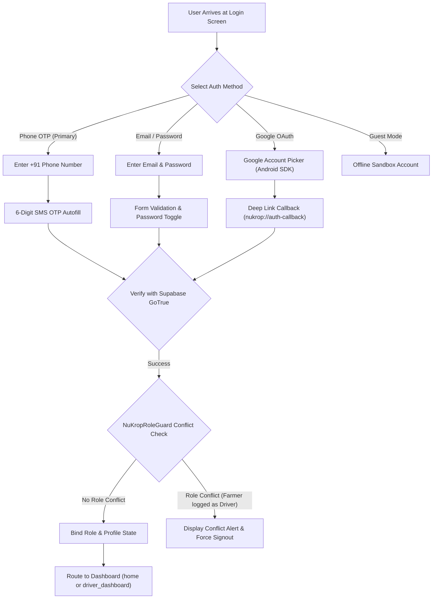

# NuKropAI — Multi-Channel Authentication Architecture

**Project:** NuKropAI — Agricultural Operating System  
**Document ID:** `DOC-AUTH-003`  
**Classification:** Security & Identity Specification  
**Status:** Canonical & Active  
**Last Updated:** November 4, 2026  

---

## 1. Authentication Channels Overview

NuKropAI supports 4 distinct authentication channels designed for rural connectivity scenarios and diverse literacy levels:



---

## 2. Authentication Channel Specifications

### 2.1. Phone Number & OTP Verification (Primary Indian Farmer Flow)
- **Phone Normalization**: Strips spaces, dashes, parentheses, and leading zeros; normalizes to E.164 format (`+919849211048`).
- **Input Attributes**: Enforces `type="tel"`, `inputmode="numeric"`, `pattern="[0-9]*"` for high-usability numeric keypad triggering on Android.
- **OTP Field**: Implements `autocomplete="one-time-code"`, allowing the Android SMS Retriever API or WebView autofill to populate the 6 digits instantly without copy-pasting.

### 2.2. Email & Password
- **Sanitization**: All emails trimmed and lowercased (`user@example.com`).
- **Visibility Toggle**: SVG eye button dynamically flips password input between `type="password"` and `type="text"`.
- **Validation**: Minimum 8 characters with strength indicator; error alerts rendered in high-contrast red without blanking screens.

### 2.3. Google OAuth Deep Link
- **Configuration**: Uses Supabase GoTrue OAuth provider with redirect URI `nukrop://auth-callback`.
- **Android Manifest Intent**: Configured in `app/src/main/AndroidManifest.xml` under `MainActivity` with `<data android:scheme="nukrop" android:host="auth-callback" />`.
- **Rehydration**: Extracts `access_token` and `refresh_token` from fragment hash and commits to session storage.

### 2.4. Guest / Offline Mode Fallback
- For farmers in deep rural areas with zero cellular reception, a local guest profile is instantiated with sample crop packages.
- All actions are queued into Safe-T-Net for synchronization upon network restoration.

---

## 3. Role Integrity & Collision Guard (`NuKropRoleGuard`)

To eliminate role hijacking and cross-role privacy leaks:
1. **Separation of Farmer & Driver Accounts**: A phone number registered as a Farmer cannot be used to log into the Driver Portal without first explicitly closing the Farmer session.
2. **Server-Authoritative Role Assignment**:
   - Client-provided `user_metadata.role` is treated as untrusted.
   - The Fastify backend and Supabase RLS policies enforce `app_metadata.role` or verify against the database table `public.drivers`.
3. **Role Conflict Resolution**:
   ```javascript
   function verifyRoleIntegrity(registeredRole, targetRole) {
     if (registeredRole && registeredRole !== targetRole) {
       showLuxuryToast(`⚠️ This account is registered as ${registeredRole}. Please switch profiles to proceed.`, 'warning');
       return false;
     }
     return true;
   }
   ```

---

## 4. Session Lifecycle & Token Management

- **Access Token TTL**: 3,600 seconds (1 hour).
- **Refresh Token Rotation**: Handled transparently by Supabase GoTrue; single-use refresh tokens prevent replay attacks.
- **Session Cleanup (`executeSignOutToLogin()`)**:
  - Clears `sb_auth_session` and `nukrop_user_uuid`.
  - Calls `NuKropSWR.invalidateUserCache()` to purge private records.
  - Re-initializes login screen without crashing active WebView memory.

