# NUKROPAI — COMPLETE DATABASE ENTITY RELATIONSHIPS

This document defines the authoritative Entity-Relationship (ER) model across all 30 production tables in the NuKropAI ecosystem.

---

## 1. Domain Relationship Hierarchy

```mermaid
erDiagram
    profiles ||--o{ land_parcels : "owns"
    profiles ||--o{ soil_health_cards : "holds"
    profiles ||--o{ kcc_applications : "applies"
    profiles ||--o{ disease_scans : "scans"
    profiles ||--o{ khata_transactions : "records"
    profiles ||--o{ community_posts : "authors"
    profiles ||--o{ community_stories : "shares"
    profiles ||--o{ community_comments : "writes"
    profiles ||--o{ post_likes : "likes"
    profiles ||--o{ user_follows : "follows"
    profiles ||--o{ peer_messages : "exchanges"
    profiles ||--o{ machinery_listings : "owns"
    profiles ||--o{ machinery_bookings : "rents"
    profiles ||--o{ haul_bookings : "books"
    profiles ||--o{ truck_listings : "operates"
    profiles ||--o{ price_alerts : "configures"

    community_posts ||--o{ community_comments : "contains"
    community_posts ||--o{ post_likes : "receives"

    machinery_listings ||--o{ machinery_bookings : "scheduled_in"
    machinery_listings ||--o{ machinery_messages : "inquires"

    haul_bookings ||--o{ trip_waypoints : "navigates"
    truck_listings ||--o{ driver_telemetry : "transmits"
    truck_listings ||--o{ driver_locations : "reports"

    biorx_recipes ||--o{ biorx_batches : "formulates"
    mandi_live_rates ||--o{ mandi_alerts : "triggers"
```

---

## 2. Table Relationship & Constraint Details

### A. Core Identity & Governance
- **`public.profiles`**: Primary root identity table. Keyed by `id TEXT` (corresponding to Supabase `auth.users.id`).
  - Child tables reference `profiles(id)` with `ON DELETE CASCADE` for user-owned records (e.g. `land_parcels`, `soil_health_cards`, `kcc_applications`, `disease_scans`, `community_stories`).
  - `khata_transactions`: References `profiles(id) ON DELETE RESTRICT` (or preserved with stubs) to protect historical financial ledgers from accidental deletion.

### B. Farm, AgriStack & Soil Records
- **`public.land_parcels`**:
  - `user_id` / `farmer_id` -> `profiles(id)` (`ON DELETE CASCADE`).
  - Indexed on `(user_id, survey_number)`.
- **`public.soil_health_cards`**:
  - `user_id` -> `profiles(id)` (`ON DELETE CASCADE`).
  - Indexed on `(user_id, sample_date DESC)`.
- **`public.kcc_applications`**:
  - `user_id` -> `profiles(id)` (`ON DELETE CASCADE`).
  - Indexed on `(user_id, status)`.

### C. Logistics, Fleet & Telemetry
- **`public.truck_listings`**:
  - `user_id` / `transporter_id` -> `profiles(id)` (`ON DELETE SET NULL`).
  - Added `vehicle_verified_status` (`PENDING`, `VERIFIED`, `REJECTED`, `SUSPENDED`, `EXPIRED`).
  - Indexed on `(status, created_at DESC)` and `(latitude, longitude)`.
- **`public.haul_bookings`**:
  - `farmer_user_id` / `farmer_id` -> `profiles(id)` (`ON DELETE CASCADE`).
  - `driver_user_id` / `driver_id` -> `profiles(id)` (`ON DELETE SET NULL`).
  - Status lifecycle: `PENDING -> ACCEPTED -> ARRIVED -> IN_TRANSIT -> COMPLETED (or CANCELLED)`.
  - Indexed on `(status, pickup_village)` and `created_at DESC`.
- **`public.driver_locations`**:
  - `driver_id` -> unique tracking key referencing `profiles(id)`.
  - `active_booking_id` -> references `haul_bookings(id) ON DELETE SET NULL`.
  - Columns: `is_on_duty`, `is_available`, `current_lat`, `current_lng`, `location geography(POINT, 4326)`, `accuracy`, `speed_kmh`, `last_ping`.
  - Spatial GiST index `idx_driver_locations_spatial` on PostGIS `location`.
  - Composite freshness index `idx_driver_locations_duty_freshness` on `(is_on_duty, is_available, last_ping DESC)`.
- **`public.driver_telemetry`**:
  - `driver_id` -> active driver identifier.
  - `booking_id` -> references `haul_bookings(id) ON DELETE SET NULL`.
  - Tracks live persistent breadcrumbs during active trips with accuracy and speed anomaly validation.
  - High-frequency temporal index on `last_ping DESC`.

### D. Social Feed & Agricultural Stories
- **`public.community_posts`**:
  - `author_id` -> `profiles(id)` (`ON DELETE CASCADE`).
  - Indexed on `(created_at DESC)` and `(crop_tag)`.
- **`public.community_comments`**:
  - `post_id` -> `community_posts(id)` (`ON DELETE CASCADE`).
  - `author_id` -> `profiles(id)` (`ON DELETE CASCADE`).
- **`public.post_likes`**:
  - Unique composite constraint: `UNIQUE(post_id, user_id)`.
- **`public.community_stories`**:
  - `user_id` / `author_id` -> `profiles(id)` (`ON DELETE CASCADE`).
  - Indexed on `(expires_at DESC)`.

### E. Financial & Commerce
- **`public.khata_transactions`**:
  - `user_id` -> `profiles(id)` (`ON DELETE RESTRICT`).
  - Indexed on `(user_id, transaction_date DESC)`.
  - Non-nullable audit trail.

