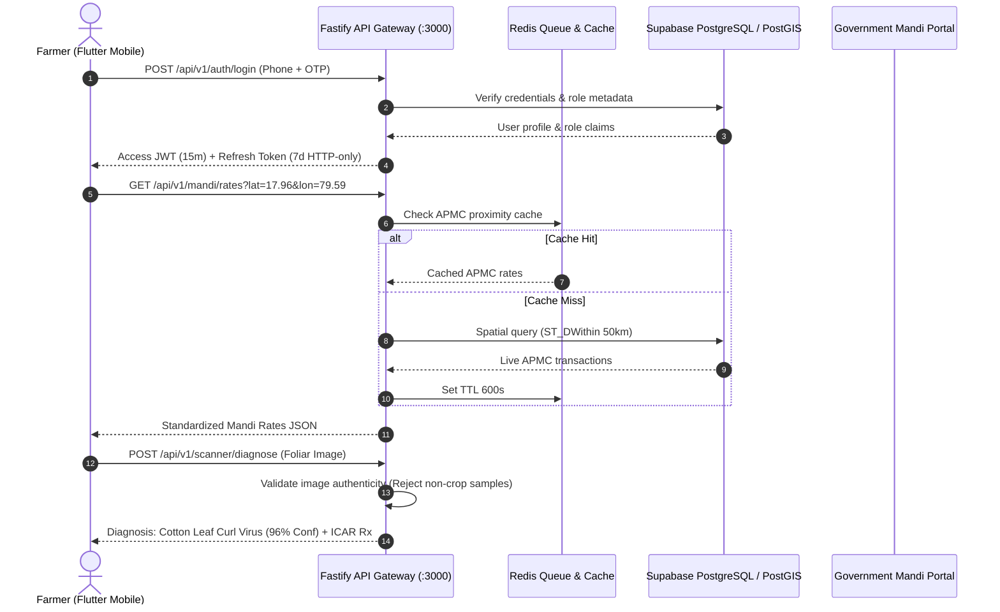

# NuKropAI — Flutter Full-Stack Integration Map

## Executive Summary
This document delineates the network communication architecture, endpoint mapping, data contracts, and real-time synchronizations connecting the Flutter mobile client (`flutter_app/`) to the Fastify enterprise backend (`backend/`) and Supabase PostgreSQL database.

---

## 1. System Communication Architecture

---

## 2. API Endpoint Directory

| Category | HTTP Method & Path | Flutter Client Caller | Backend Handler | Database / Target |
| :--- | :--- | :--- | :--- | :--- |
| **Auth** | `POST /api/v1/auth/register` | `ApiClient.register` | `auth.controller.ts` | `users`, `farmer_profiles` |
| **Auth** | `POST /api/v1/auth/login` | `ApiClient.login` | `auth.controller.ts` | `users`, `refresh_tokens` |
| **Auth** | `POST /api/v1/auth/refresh` | `ApiClient.refreshToken`| `auth.controller.ts` | Token rotation table |
| **Mandi** | `GET /api/v1/mandi/rates` | `ApiClient.getMandiRates` | `mandi.controller.ts` | `mandi_prices`, PostGIS |
| **Community**| `GET /api/v1/community/feed`| `ApiClient.getPosts` | `community.controller.ts`| `posts`, `comments` |
| **Scanner**| `POST /api/v1/scanner/diagnose`| `ApiClient.diagnoseCrop` | `scanner.controller.ts` | Groq Vision / ICAR db |
| **Freight** | `POST /api/v1/trips/book` | `ApiClient.bookTrip` | `trip.controller.ts` | `trips`, `driver_locations` |
| **Ledger** | `POST /api/v1/khata/entries`| `ApiClient.saveKhata` | `khata.controller.ts` | `farm_khata_ledger` |
| **Health** | `GET /health` | App initialization | `server.ts` | PostgreSQL ping |
