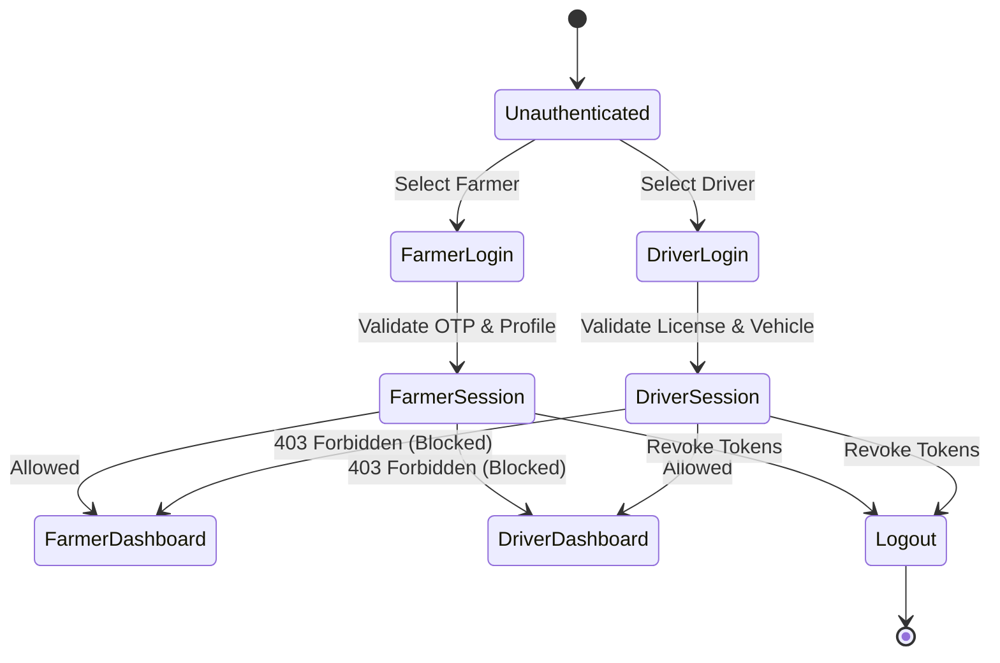

# NuKropAI — Identity Migration & Authentication Report

## Executive Summary
This report documents the enterprise identity, authentication, session management, and role-based access control (RBAC) architecture of NuKropAI across both the Fastify backend and the Flutter mobile client.

---

## 1. Identity Architecture & Cryptographic Tokens
- **Access Tokens**: Short-lived JSON Web Tokens (15-minute expiration) signed with HMAC-SHA256 (`HS256`). Claims include `sub` (User UUID), `role` (`farmer`, `driver`, `admin`), `aud` (`authenticated`), and `iss` (`nukrop-auth`).
- **Refresh Tokens**: Dedicated `JWT_REFRESH_SECRET` signed tokens (7-day lifetime) with `jti` UUID stored hashed using SHA-256 pre-hashing + bcrypt in the database.
- **Token Rotation & Anti-Replay**: Each token refresh rotates both access and refresh tokens. If a spent refresh token is reused, all sessions associated with that token family are revoked immediately.
- **Storage**: Mobile tokens are stored in hardware-backed secure storage via `flutter_secure_storage` (Android KeyStore / iOS Keychain).

---

## 2. Role-Based Access Control (RBAC) Standards

---

## 3. Automated Security Test Results
The backend authentication engine is verified by comprehensive test suites:
- **`tests/test_jwt_auth_security.js`**: 13/13 tests PASSED (Zero hardcoded fallback secrets, fail-closed behavior, signature verification, audience/issuer strictness, role forgery blocking).
- **`tests/test_jwt_controller_integration.js`**: 12/12 tests PASSED (Register, Login, Refresh token rotation, Replay attack session revocation, Logout revocation, Role boundary enforcement).

