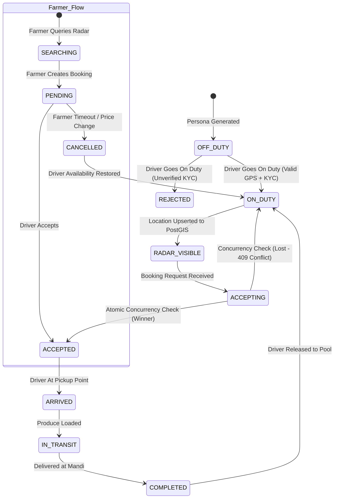

# NuKropAI — MiroFish Synthetic User Personas & Behavioral Scenarios

**System:** NuKropAI Agrarian Operating System  
**Engine:** MiroFish Swarm Intelligence Adapter  
**Geographic Domain:** Telangana & Andhra Pradesh Agricultural Corridors (Hyderabad, Rangareddy, Medchal, Warangal, Suryapet)  
**Classification:** STRICTLY SIMULATED AGENTS (No Real User or Driver Data)

---

## 1. Synthetic Persona Catalog (9 Archetypes)

The simulation engine synthesizes 9 realistic agrarian persona categories modeled after authentic operational conditions across Indian agricultural value chains:

```
┌─────────────────────────────────────────────────────────────────────────────┐
│                       9 SYNTHETIC PERSONA ARCHETYPES                        │
├─────────────────────────────────────────────────────────────────────────────┤
│  1. Farmers (Marginal, Medium Commercial, Peri-Urban Horticulture)          │
│  2. Verified Drivers (Tata Ace, Bolero, Dost, Eicher Operators)             │
│  3. Unverified Drivers (Incomplete KYC, Document Rejection Testing)         │
│  4. Agricultural Transport Operators (Regional Fleet Managers)              │
│  5. Machinery Owners (Custom Hiring Centers, Harvester/Tractor Operators)   │
│  6. Agricultural Equipment Renters (Smallholders Needing Seasonal Tools)    │
│  7. Mandi Traders & Commission Agents (APMC Yard Consignment Receivers)      │
│  8. Agricultural Service Providers & Agronomists (LeafNet Vision Reviewers) │
│  9. Platform Administrators (KYC Compliance & Safety Audit Officers)        │
└─────────────────────────────────────────────────────────────────────────────┘
```

### Detailed Persona Profiles

| Persona Archetype | Subtypes & Crops | Operational Goals | Constraints & Latencies | Failure / Cancellation Triggers |
| :--- | :--- | :--- | :--- | :--- |
| **1. Smallholder Farmer** | Marginal Cultivator (1–2 acres), Paddy, Tomatoes | Minimum fare transport (< ₹1,200), immediate mandi delivery | Low cash buffer, requires Tata Ace (1.5T) | Cancels if driver ETA > 20 mins; highly sensitive to price surges. |
| **2. Commercial Farmer** | Medium Agri-Business (10–25 acres), Cotton, Chilli | High-capacity vehicle (3.5–4.5T), scheduled multi-trip pickups | Quality standards, requires prompt transit tracking | Cancels if vehicle capacity < 3 tonnes; monitors GPS closely. |
| **3. Peri-Urban Horticulture** | Intensive Veg/Flower grower (Medchal/Shamshabad), Papaya, Chillies | Fast dispatch to Bowenpally/Gaddiannaram morning auctions | Perishable produce with narrow 3-hour freshness window | Cancels if driver acceptance takes > 180 seconds. |
| **4. Verified Driver** | Owner-Operator / Fleet Pilot, Tata Ace Gold, Bolero Maxi | Maximize daily trips (3–5 trips), avoid empty backhauls | Fuel cost awareness, prefers pickups within 8 km | Rejects bookings offering < ₹800; goes OFF DUTY during midday lull. |
| **5. Unverified Driver** | New Applicant, Pending or Incomplete KYC documents | Attempt to access driver marketplace and earn haul fares | Blocked by server-side verification guard (`DRIVER_NOT_VERIFIED`) | Correctly rejected with HTTP 200/400 upon attempting duty toggle. |
| **6. Fleet Operator** | Logistics Enterprise (5–10 trucks), Rangareddy / Warangal | Multi-vehicle dispatch, maximize fleet utilization rate | Driver attendance tracking, vehicle maintenance | Dispatches secondary truck if primary driver is delayed. |
| **7. Machinery Owner** | Custom Hiring Center, John Deere 5050D, Combine Harvester | Lease tractors & harvesters at hourly/daily rental rates | High capital investment, seasonal demand spikes | Rejects rental if transit distance exceeds 20 km. |
| **8. Equipment Renter** | Tenant Cultivator, Seedbed preparation, Rotavators | Micro-rent machinery for 2–3 day cultivation windows | Limited budget, strict sowing calendar deadlines | Cancels if machinery is unavailable within 48 hours of sowing. |
| **9. Mandi Trader** | APMC Commission Agent (Bowenpally Yard, Warangal Enamamula) | Receive verified produce consignments, assess arrival volumes | Market opening hours (4:00 AM – 11:00 AM) | Flags delayed consignments arriving after auction closure. |

---

## 2. Behavioral Simulation Scenarios Matrix (Scenarios A through H)

```
┌─────────────────────────────────────────────────────────────────────────────┐
│                            SIMULATION SCENARIOS                             │
├─────────────────────────────────────────────────────────────────────────────┤
│  [A] Normal Day:         50 Farmers + 10 Drivers (Equilibrium Baseline)     │
│  [B] Peak Harvest:       100 Farmers + 20 Drivers (High Density & Volume)   │
│  [C] Driver Shortage:    50 Farmers + 3 Drivers (Severe Supply Deficit)     │
│  [D] High Demand Stress: 200 Farmers + 30 Drivers (Concurrency Stress)      │
│  [E] Network Failure:    Selected Drivers Drop Signal (Stale Pruning >5m)   │
│  [F] Concurrency Race:   5 Drivers Compete for 1 Booking (Single-Winner)   │
│  [G] Cancellation Surge: 80% Farmer Cancellation Rate (Instant Release)     │
│  [H] Out-of-Bounds:      Pickups > 15 km Excluded by PostGIS Radar          │
└─────────────────────────────────────────────────────────────────────────────┘
```

### Scenario Details & Expected System Responses

### Scenario A: Normal Day (Marketplace Baseline)
* **Configuration:** 50 Farmers, 10 Verified Drivers.
* **Operational Pattern:** Farmers create haul bookings across morning hours (6:00 AM – 9:00 AM). Available drivers within 10 km query radar and accept in FIFO sequence.
* **Expected System Response:** ~20% of bookings immediately assigned (1:5 driver-to-farmer ratio). Active drivers complete trips, release availability, and accept subsequent loads. Zero concurrency deadlocks.

### Scenario B: Peak Harvest Surge
* **Configuration:** 100 Farmers, 20 Verified Drivers, 5 Fleet Operators.
* **Operational Pattern:** Sowing or harvest surge generates simultaneous haul requests within a 30-minute window across Warangal and Rangareddy belts.
* **Expected System Response:** 100% driver fleet utilization. High PostGIS radar query throughput. Average booking acceptance latency under 8 seconds.

### Scenario C: Driver Shortage / Crisis
* **Configuration:** 50 Farmers, 3 Verified Drivers.
* **Operational Pattern:** Severe transport scarcity. Available drivers are immediately claimed.
* **Expected System Response:** 3 bookings accepted and locked. Remaining 47 bookings stay in `PENDING` status until farmer timeout triggers cancellation. Fares remain tamper-proof. Zero duplicate assignments.

### Scenario D: High Demand Stress (Concurrency Spike)
* **Configuration:** 200 Farmers, 30 Drivers.
* **Operational Pattern:** Concurrency stress testing radar queries and booking transactions.
* **Expected System Response:** Sub-500ms PostGIS spatial query response times. PostgreSQL connection pool scales cleanly without connection exhaustion.

### Scenario E: Network Failure & Stale Telemetry Pruning
* **Configuration:** 10 Drivers transmitting live telemetry; 4 drivers abruptly lose connectivity (simulating rural network dead zones).
* **Operational Pattern:** Pings cease. Driver positions age past 5 minutes in `driver_locations`.
* **Expected System Response:** PostGIS radar query `WHERE dl.updated_at >= (NOW() - INTERVAL '5 minutes')` automatically excludes stale drivers from farmer search results. Reconnection restores visibility instantly.

### Scenario F: Booking Competition Race
* **Configuration:** 1 Farmer creates a lucrative produce load (₹2,500 agreed fare); 5 nearby verified drivers simultaneously attempt acceptance.
* **Operational Pattern:** High-frequency concurrent `PATCH /rest/v1/haul_bookings?id=eq.{id}&status=eq.PENDING` calls from 5 independent driver sessions.
* **Expected System Response:** Exactly **one driver wins** (HTTP 200). The remaining four drivers receive **HTTP 409 Conflict** (`BOOKING_ALREADY_ACCEPTED`). Zero duplicate driver assignments.

### Scenario G: Cancellation Surge
* **Configuration:** 10 Farmers request transport; sudden market price drop prompts 80% of farmers to cancel before driver arrival.
* **Operational Pattern:** Farmers execute `status = CANCELLED`.
* **Expected System Response:** Haul booking state transitions cleanly. Assigned drivers are immediately released (`active_booking_id = NULL`, `is_available = true`) and return to the active marketplace pool.

### Scenario H: Long-Distance & Out-of-Bounds Exclusion
* **Configuration:** Farmers located in Sangareddy (>25 km away) query transport; available drivers are located in Secunderabad/Bowenpally.
* **Operational Pattern:** Query PostGIS `get_nearest_drivers` with standard 10 km radius.
* **Expected System Response:** Server returns empty JSON array `[]`. Prevents drivers from being dispatched across excessive deadhead distances.

---

## 3. Agent Lifecycle State Machine



