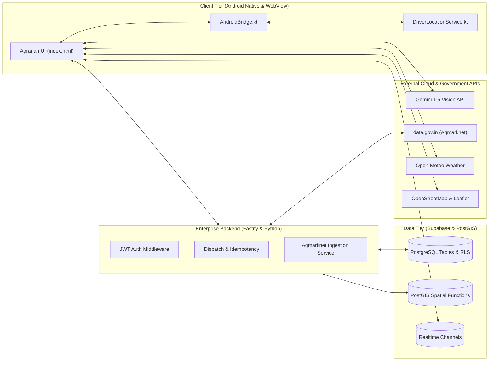

# NuKropAI — Full-Stack Module Integration Map

**Project:** NuKropAI — Agricultural Operating System  
**Document ID:** `DOC-MOD-005`  
**Classification:** Full-Stack Architecture & API Integration Specification  
**Status:** Canonical & Active  
**Last Updated:** November 4, 2026  

---

## 1. System Integration Architecture

NuKropAI operates as a hybrid agrarian OS across three execution tiers:
1. **Client Tier**: Android Native Wrapper (`AndroidBridge`, `DriverLocationService`) + WebView Single-Page Engine (`index.html`).
2. **API & Service Tier**: Fastify + TypeScript backend (`backend/src/`) with fail-closed JWT auth and Agmarknet ingestion pipeline.
3. **Data Tier**: Supabase PostgreSQL + PostGIS spatial functions with Row Level Security (RLS) enforcement.

---

## 2. Comprehensive Module Integration Matrix

| Module | Primary Screen | Client Trigger / Component | Backend API / Service | Database Tables & RPCs | External Dependency | Fallback Mode |
| :--- | :--- | :--- | :--- | :--- | :--- | :--- |
| **AI Crop Scanner** | `scanner` | `startScannerDiagnostic()`, `takeFoliarPhoto()` | Gemini Vision API direct POST | `crop_diagnostics` (RLS) | Gemini 1.5 Flash Vision | On-device mock foliar classifier with ICAR remedies |
| **APMC Mandi Bhav** | `market` | `fetchMandiRatesFromSupabase()` | `/api/v1/mandi/rates` | `mandi_prices` | Agmarknet (`data.gov.in`) | SWR cached mandi prices with MSP benchmarks |
| **GramHaul Dispatch** | `gramhaul` | `submitGramhaulBooking()`, `initGramhaulOpenStreetMap()` | `/api/v1/dispatch/book` | `dispatch_bookings`, `truck_listings` | Leaflet & OSM Carto | Local Haversine nearest-truck estimation |
| **GramHaul Tracking** | `gramhaul_tracking` | `subscribeToTripUpdates()`, `verifyTripOtp()` | `/api/v1/dispatch/telemetry` | `get_nearest_drivers`, `driver_locations` | Physical GPS / Device sensors | Route checkpoint interpolation |
| **Kisan Community** | `community` | `submitNewCommunityPost()`, `toggleCommunityLike()` | Supabase PostgREST | `community_posts`, `post_likes`, `user_follows` | Supabase Realtime | Optimistic DOM updates with rollback on failure |
| **Farm Khata** | `khata` | `saveKhataEntry()`, `deleteKhataEntry()` | Supabase PostgREST | `farm_khata` (RLS) | Local SharedPreferences | Optimistic removal with 5s undo toast |
| **Pest Surveillance** | `bioshield` | `fetchDynamicPestAlerts()` | Local & Supabase RPC | `pest_surveillance_alerts` | State Agro-climatic data | Multi-state offline fallback matrix (TS, MH, PB, GJ) |
| **BioRx Sprayer** | `biorx` | `calculateBioRxTankMix()` | Pure Client Math Engine | N/A (Precomputed matrices) | CIB&RC Spray Guidelines | Instant offline calculation |
| **Soil N-P-K** | `calc_fert` | `calculateFertilizerDose()` | Pure Client Math Engine | `soil_health_records` | ICAR Soil Testing Manual | Offline N-P-K calibration tables |
| **KCC Loan Calculator** | `loan` | `calculateKccLoanLimit()` | Pure Client Math Engine | `kcc_applications` | RBI Scale of Finance 2026 | Instant scale of finance estimation |
| **Digital AgriStack** | `agristack` | `renderAgristackBoundary()` | PostGIS GeoJSON API | `farm_parcels` (PostGIS `ST_GeomFromGeoJSON`) | Dharani / Bhu-Aadhaar | Cached boundary polygons |
| **Agronomy AI Chat** | `chat` | `sendAgronomyChatMessage()` | Fastify `/api/v1/chat` | `chat_conversations` | Google Gemini API | Local agronomy rule-based FAQ |
| **Driver Cockpit** | `driver_dashboard`| `toggleDriverAvailability()`, `acceptHaulTrip()` | Fastify `/api/v1/dispatch/accept` | `drivers`, `dispatch_bookings` | Android Foreground GPS | In-memory driver availability lock |

---

## 3. Persistent Idempotency Integration

All payment-sensitive and duplicate-prone endpoints (`/api/v1/dispatch/book`, `/api/v1/dispatch/accept`) integrate with `IdempotencyService.ts`:
1. **Client**: Generates header `Idempotency-Key: booking_<timestamp>_<rand>`.
2. **Server L1**: In-memory LRU cache checked within <1ms.
3. **Server L2**: PostgreSQL table `public.idempotency_keys` locked atomically via `ON CONFLICT (key) DO NOTHING`.
4. **Replay**: Duplicate requests within the 24-hour TTL receive the identical cached response status and payload without duplicating bookings.
