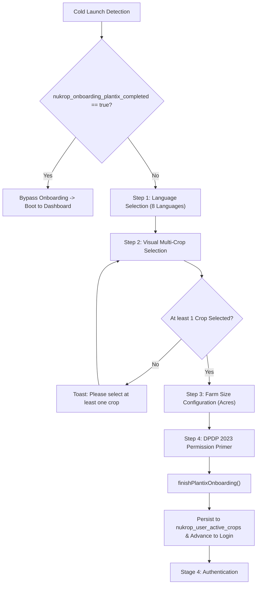

# NuKropAI — Agrarian Onboarding Experience & State Engine

**Project:** NuKropAI — Agricultural Operating System  
**Document ID:** `DOC-ONBOARD-004`  
**Classification:** UX & Initialization Flow Specification  
**Status:** Canonical & Active  
**Last Updated:** November 4, 2026  

---

## 1. Onboarding Architectural Overview

NuKropAI implements a Plantix-style visual onboarding flow tailored for smallholder Indian farmers. It bridges language barriers through rich iconography, localized terminology, and tactile touch interactions.

---

## 2. Step-by-Step Flow Specifications

### Step 1: Language Selection
- **Supported Languages**:
  1. English (`en`)
  2. Telugu / తెలుగు (`te`)
  3. Hindi / हिन्दी (`hi`)
  4. Tamil / தமிழ் (`ta`)
  5. Kannada / ಕನ್ನಡ (`kn`)
  6. Marathi / मराठी (`mr`)
  7. Punjabi / ਪੰਜਾਬੀ (`pa`)
  8. Gujarati / ગુજરાતી (`gu`)
- **Persistence**: Selected code stored in `localStorage.nukrop_lang`; immediately triggers `setLanguage(lang)` to re-render all UI labels.

### Step 2: Visual Multi-Crop Selection (Plantix Pattern)
- **Crop Catalog**: Visual svg/png tiles from `MASTER_120_CROPS` including Cotton (పత్తి / कपास), Chilli (మిర్చి / मिर्च), Paddy (వరి / धान), Maize (మొక్కజొన్న / मक्का), Tomato, Groundnut, Soybean, and Wheat.
- **Selection State**: Stored in `plantixFlowState.selectedCrops`.
- **Validation**: Enforced by `finishPlantixOnboarding()`. If zero crops are selected, the action is blocked with a high-visibility warning toast.

### Step 3: Farm Acreage & Cropping Season
- **Inputs**: Acreage selector (e.g. 1–50 acres) and Kharif / Rabi seasonal indicator.
- **Impact**: Calibrates the KCC Loan limit calculator, fertilizer N-P-K recommendation engine, and BioRx knapsack sprayer dilution calculations.

### Step 4: Permission Primer (DPDP Act 2023 Compliant)
- **Explicit Purpose Specification**:
  - **Location (`ACCESS_FINE_LOCATION`)**: Localized mandi prices and micro-weather forecasts.
  - **Camera (`CAMERA`)**: Foliar leaf diagnostics and leaf curl virus detection.
- **User Agency**: Farmer can grant or deny permissions without crashing the app; denied permissions automatically switch to manual district selectors.

---

## 3. Replaying Onboarding Experience

Farmers can re-open the onboarding and splash experience at any time without resetting their user account:
- **Trigger**: Profile -> Settings -> `Replay Splash Tour` or `Manage Active Crops`.
- **API**: `replayStartupExperience(slideIndex)` mounts `#startup-experience-overlay` without destroying the background dashboard state.
- **Safe Exit**: `closeStartupExperienceAndReturn()` smoothly unmounts the overlay and returns the user to the active screen.
