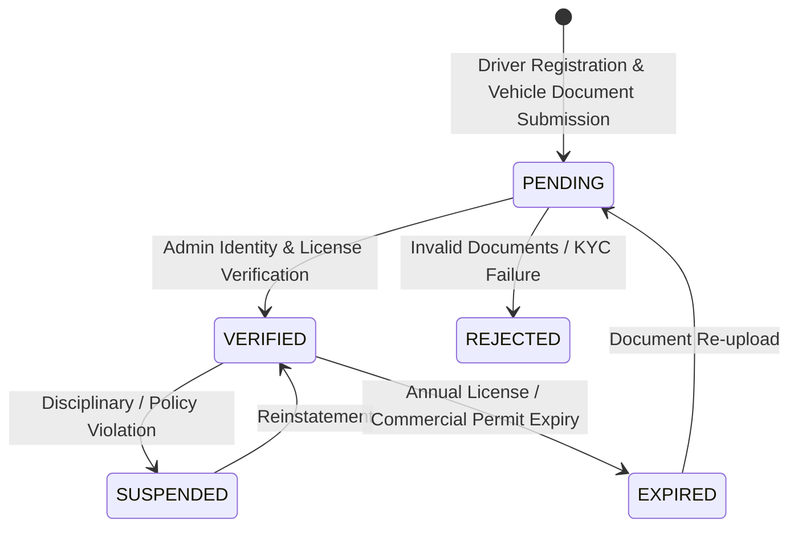
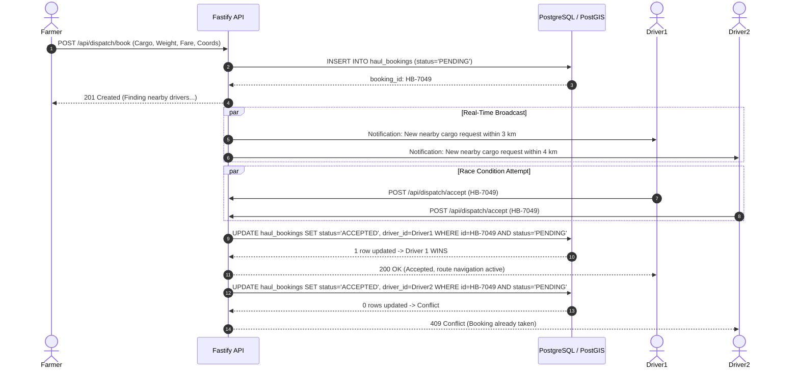

# NuKropAI — Real-Time Driver Marketplace, Live Dispatch & GPS Tracking

**Architecture & Operational Guide: Rapido-Style Agrarian Logistics Dispatch**  
**Version:** 2.0.0-PROD  
**Status:** IMPLEMENTED & EMPIRICALLY VERIFIED  
**Compliance:** DPDP Act 2023, Multi-Tenant Row Level Security, PostGIS Geospatial LBS

---

## 1. Executive Architecture Summary

NuKropAI's **GramHaul Logistics Engine** transforms rural farm-to-mandi agricultural transportation into an autonomous, real-time, on-demand dispatch network. Modeled after hyper-local ride-booking architectures (e.g. Rapido) and specialized for agricultural cargo, the system enforces:

1. **Strict Driver & Vehicle Verification:** Zero unverified or unvetted accounts may enter the marketplace. Driver identity (`driver_verified_status`) and vehicle roadworthiness (`vehicle_verified_status`) require auditable review before dispatch eligibility.
2. **Deterministic ON-DUTY / OFF-DUTY Presence:** A driver only participates in matching when explicitly switched ON DUTY with verified physical device GPS coordinates. Switching OFF DUTY stops discovery while preserving active trip tracking.
3. **Server-Enforced 10 km PostGIS Nearby Matching:** Distance queries are executed inside PostgreSQL using indexed `geography(POINT, 4326)` columns and `ST_DWithin(...)`. No unfiltered driver dumps or client-side calculation.
4. **Concurrency-Safe Atomic Booking Acceptance:** When multiple nearby drivers attempt to accept the same booking request simultaneously, database row-level locking / conditional atomic updates guarantee exactly one winner with zero duplicate assignments.
5. **Real-Time GPS Tracking & Telemetry Defense:** Driver position updates are authenticated, verified against GPS accuracy thresholds (<= 50m), and analyzed for impossible speed jumps (> 160 km/h) before persistence in `driver_telemetry` and broadcast over Supabase Realtime channels.

---

## 2. Driver Lifecycle & Verification States



### Verification States:
* `PENDING`: Initial state upon driver registration. Access to haul dispatch is blocked.
* `VERIFIED`: Granted after KYC, driving license, and vehicle registration verification. Eligible to go ON DUTY.
* `REJECTED`: Documents invalid. Cannot go ON DUTY.
* `SUSPENDED`: Temporarily restricted from receiving dispatch offers.
* `EXPIRED`: Permit or registration expired; driver automatically blocked until re-verification.

---

## 3. PostGIS Geospatial Engine & 10 km Matching

### Database Implementation
* **Table:** `public.driver_locations`
* **Column:** `location geography(POINT, 4326)`
* **Index:** `idx_driver_locations_spatial ON public.driver_locations USING GIST (location)`
* **Compound Index:** `idx_driver_locations_duty_freshness (is_on_duty, is_available, last_ping DESC)`

### Matching Criteria Enforced by Server:
```sql
SELECT 
  dl.driver_id, dl.driver_name, dl.vehicle_number, dl.vehicle_type,
  ST_Distance(dl.location, v_farmer_geog) AS distance_meters
FROM public.driver_locations dl
JOIN public.profiles p ON p.id = dl.driver_id
WHERE dl.is_on_duty = true
  AND dl.is_available = true
  AND dl.active_booking_id IS NULL
  AND dl.last_ping >= (NOW() - INTERVAL '5 minutes')
  AND p.driver_verified_status = 'VERIFIED'
  AND ST_DWithin(dl.location, v_farmer_geog, 10000);
```

---

## 4. Booking Lifecycle & Atomic Concurrency



---

## 5. Live Tracking & Multi-Tenant Isolation

1. **Farmer Live Map:**
   * Shows assigned vehicle marker moving in real time as driver device transmits pings.
   * If driver stops sending updates for > 5 minutes, UI displays:  
     `"Waiting for driver's latest location..."`
2. **Data Privacy (DPDP Compliance):**
   * Precise driver location coordinates are shared **only** with the farmer owning that active ongoing booking (`haul_bookings.status IN ('ACCEPTED', 'ARRIVED', 'IN_TRANSIT')`).
   * Unrelated farmers receive HTTP 403 Forbidden.
   * After trip completion (`COMPLETED`), real-time tracking stream terminates immediately.

---

## 6. API Route Inventory

| Method | Endpoint | Access Role | Description |
| :--- | :--- | :--- | :--- |
| `POST` | `/api/dispatch/duty` | `driver`, `admin` | Toggles ON/OFF duty; requires valid GPS to go ON DUTY. |
| `POST` | `/api/dispatch/location` | `driver`, `admin` | Live GPS ping with accuracy & jump anomaly defense. |
| `GET` | `/api/dispatch/nearby` | Authenticated | Server-enforced 10 km PostGIS search for verified drivers. |
| `POST` | `/api/dispatch/book` | `farmer`, `admin` | Creates agricultural transport booking in `PENDING` state. |
| `POST` | `/api/dispatch/accept` | `driver`, `admin` | Concurrency-safe atomic booking acceptance. |
| `POST` | `/api/dispatch/trip-status` | Participants | Advances lifecycle (`ARRIVED`, `IN_TRANSIT`, `COMPLETED`). |
| `GET` | `/api/dispatch/track/:id` | Assigned Farmer/Driver | Live driver position, telemetry, and trip telemetry stream. |
