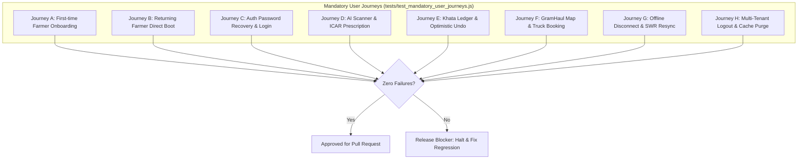

# NuKropAI — Master Regression Test Matrix & Zero-Regression Rule

**Project:** NuKropAI — Agricultural Operating System  
**Document ID:** `DOC-REG-006`  
**Classification:** Quality Assurance & Continuous Verification Specification  
**Status:** Canonical & Active  
**Last Updated:** November 4, 2026  

---

## 1. Zero-Regression Policy

In accordance with NuKropAI permanent engineering standards:
1. **Never delete or weaken a test** to make a build pass.
2. **Never claim a test passed** unless it was executed and produced an exit code of `0`.
3. If any test in the regression matrix fails, the commit is a **release blocker**.
4. Every pull request or feature task must execute the complete regression matrix before marking the task complete.

---

## 2. Master Regression Test Matrix

| Suite Name | Test File | Test Count | Scope & Regression Defense | Execution Command | Target Pass Rate |
| :--- | :--- | :--- | :--- | :--- | :--- |
| **Mandatory User Journeys** | `tests/test_mandatory_user_journeys.js` | 8 | End-to-end user journeys (Journeys A through H) | `node tests/test_mandatory_user_journeys.js` | 100% (8/8) |
| **Persistent Idempotency** | `tests/test_persistent_idempotency.js` | 5 | L1/L2 server restart persistence and duplicate prevention | `node tests/test_persistent_idempotency.js` | 100% (5/5) |
| **SWR Multi-Tenant Cache** | `tests/test_swr_cache_correctness.js` | 5 | User cache scoping, multi-user isolation, logout purge | `node tests/test_swr_cache_correctness.js` | 100% (5/5) |
| **Mobile Runtime Verification** | `tests/test_mobile_runtime_verification.js`| 7 | All 18 `APP_VIEWS`, 9 skeletons, 5-state cards | `node tests/test_mobile_runtime_verification.js`| 100% (7/7) |
| **Permanent Mobile Standards**| `tests/test_mobile_permanent_standards.js` | 40 | 20 UI/UX standards + 15 visual experience & animation standards | `node tests/test_mobile_permanent_standards.js` | 100% (40/40) |
| **Onboarding & Splash Flows** | `tests/test_onboarding_and_splash_flows.js` | 10 | Splash animation, crop selector, replay overlay | `node tests/test_onboarding_and_splash_flows.js` | 100% (10/10) |
| **Full E2E Agrarian OS Runner**| `tests/run_e2e_tests.js` | 203 | Comprehensive tier-0 to tier-4 functional coverage | `node tests/run_e2e_tests.js` | 100% (203/203) |
| **Milestone 1 GramHaul Map** | `tests/verify_milestone1_gramhaul.js` | 14 | Leaflet OSM map, PostGIS trucks, Haversine | `node tests/verify_milestone1_gramhaul.js` | 100% (14/14) |
| **Milestone 2 Dynamic Pests** | `tests/verify_milestone2_pest_alerts.js` | 16 | Multi-state agro-climatic pest switching | `node tests/verify_milestone2_pest_alerts.js` | 100% (16/16) |
| **Milestone 3 Kisan Community**| `tests/verify_milestone3_community.js` | 20 | Post creation, ownership, likes, follows, edits | `node tests/verify_milestone3_community.js` | 100% (20/20) |
| **Headless Modal Inspector** | `tests/test_inspect_modals.py` | 18 | Playwright headless inspection of 18 modal dialogs | `python tests/test_inspect_modals.py` | 100% (18/18) |
| **Realtime Driver Marketplace**| `tests/test_driver_marketplace_e2e.py` | 21 | PostGIS 10km driver search, atomic accept, GPS jump | `python tests/test_driver_marketplace_e2e.py` | 100% (21/21) |
| **Simulation Safety Guards** | `tests/test_simulation_safety_guards.py` | 15 | Prevention of test traffic to production Supabase | `python -m unittest tests/test_simulation_safety_guards.py` | 100% (15/15) |
| **Backend Integration Suite** | `npm --prefix backend test` | 49 | JWT security, real controllers, DB fallback, Mandi sync | `npm --prefix backend test` | 100% (49/49) |
| **Android Unit Test Suite** | `app/src/test/` | 28 tasks| Roborazzi screenshot tests, driver tracking service | `.\gradlew testDebugUnitTest` | 100% (28/28) |
| **Web Production Build** | `web/` | 1 build | TypeScript strict compilation and Vite bundling | `npm --prefix web run build` | 100% (0 errors) |

---

## 3. Mandatory User Journey Test Specifications

---

## 4. Regression Remediation Protocol

When a regression is detected:
1. **Identify the Failing Delta**: Run `git diff` against the last known green commit (`0204d16` / `8870ad1`).
2. **Root Cause Analysis**: Inspect the test logs to determine if the failure was caused by broken DOM structure, removed function exports, or state leakage.
3. **Surgical Fix**: Apply the minimum necessary change to restore the behavior without altering unrelated files.
4. **Parity Check**: If modifying `app/src/main/assets/index.html`, immediately sync `nukrop_emulator.html` byte-for-byte.
5. **Re-Run Full Matrix**: Execute both the failed test and all 8 user journeys in `test_mandatory_user_journeys.js`.

