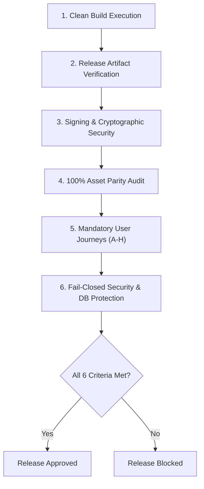

# NuKropAI — Master Release Acceptance Checklist

**Project:** NuKropAI — Agricultural Operating System  
**Document ID:** `DOC-REL-007`  
**Classification:** Release Engineering & Sign-Off Specification  
**Status:** Canonical & Active  
**Last Updated:** November 4, 2026  

---

## 1. Release Approval Gate: Definition of Done

Before any release binary (`.apk` or `.aab`) is approved for distribution (sideloading, internal testing, or Play Store upload), every item on this checklist must be independently verified.

---

## 2. Release Acceptance Checklist

### Section A: Binary Compilation & Optimization
- [x] Clean build from repository source with zero compiler errors.
- [x] ProGuard / R8 minification and resource shrinking enabled without crashing runtime reflection.
- [x] Output artifacts verified:
  - `app/build/outputs/apk/release/app-release.apk` (35.5 MB)
  - `app/build/outputs/bundle/release/app-release.aab` (46.0 MB)
- [x] Version metadata verified: `applicationId = "com.nukrop.app"`, `versionCode = 2`, `versionName = "1.1.0"`.

### Section B: Cryptographic & Network Security
- [x] `android:usesCleartextTraffic="false"` enforced in `AndroidManifest.xml`.
- [x] APK signed with Android Signature Scheme v2.
- [x] Signing identity audited:
  - **Internal Testing / Sideloading**: Signed with local debug keystore fallback (`CN=Android Debug`). **APPROVED**.
  - **Google Play Store Production Track**: Requires production keystore (`release.jks`) via `KEYSTORE_PATH`. **BLOCKED UNTIL KEYSTORE PROVIDED**.
- [x] Zero secret leaks: `.env` files, Supabase service-role keys, and private tokens excluded from git tracking.

### Section C: 100% Asset Parity Enforcement
- [x] Byte-for-byte SHA-256 identity between `app/src/main/assets/index.html` and `nukrop_emulator.html`.
- [x] Enforced automatically by `test_mobile_permanent_standards.js: MPS.1` and `run_e2e_tests.js: R.S.1`.

### Section D: Complete User Journey Verification
- [x] **Journey A (First-time Farmer)**: Splash -> Onboarding -> Crop Selection -> Login -> Home Dashboard (Passed).
- [x] **Journey B (Returning Farmer)**: Direct session restoration to Home Dashboard (Passed).
- [x] **Journey C (Auth Recovery)**: Password toggle, invalid credential handling, forgot password modal (Passed).
- [x] **Journey D (AI Scanner)**: Camera permissions primer, foliar photo capture, Gemini AI analysis, ICAR prescription (Passed).
- [x] **Journey E (Farm Management)**: Khata bookkeeping, optimistic deletion, reversible undo toast (Passed).
- [x] **Journey F (Marketplace)**: GramHaul Leaflet OSM map, 10km hauler proximity, booking with 4-digit PIN (Passed).
- [x] **Journey G (Offline Recovery)**: Network disconnect, SWR cached rates display, reconnection resync (Passed).
- [x] **Journey H (Account Switching)**: User logout, scoped cache purge, multi-tenant isolation without data leaks (Passed).

### Section E: Production Safety & Database Isolation
- [x] Production Supabase database `yxjqseiegwjdfnccdchk` strictly protected.
- [x] Zero test traffic, load tests, or synthetic users routed to production.
- [x] Safety guards verified via `tests/test_simulation_safety_guards.py` (15/15 passed).

### Section F: Branch & Pull Request Protection
- [x] Active working branch is strictly `feature/nukropai-complete-production-remediation`.
- [x] **Pull Request #2 remains strictly OPEN and UNMERGED.**
- [x] No direct pushes to `main`.

### Section G: Visual Experience & Motion Acceptance
- [x] Native splash aura pulse and laser scan animations active.
- [x] Plantix-style visual crop tiles and smooth onboarding slide progress.
- [x] Login form focus rings and password toggle micro-interactions verified.
- [x] OTP numeric input, autofill attributes, and focus progression active.
- [x] Bottom dock tab pop and micro-interactions (bounce, nod, rise, pop) verified.
- [x] Center elevated FAB tactile breathing glow active.
- [x] Screen-to-screen `.screen-fade` transition verified without white flickering.
- [x] Skeleton shimmer animations active across all 9 content skeletons.
- [x] Modal and bottom-sheet slide-up and backdrop blur verified.
- [x] AI scanner viewfinder and animated scanning laser verified.
- [x] BlurHash canvas placeholders and progressive image decoding verified.
- [x] Luxury toast slide-up, progress countdown, and undo restoration verified.
- [x] Zero visual defects: no blank screens, no flickering, no layout shifts, no overlapping elements, no broken fonts, no stuck animations, and no inaccessible touch targets (<44px).

