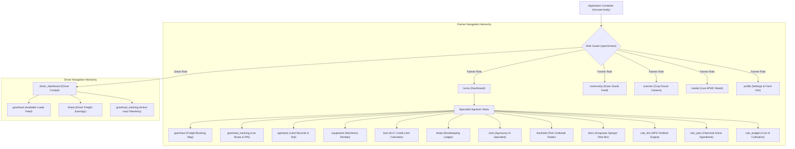
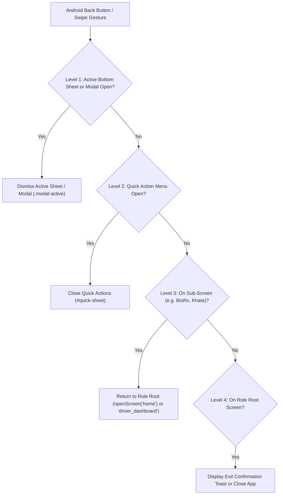

# NuKropAI — Screen Navigation Map & Routing Hierarchy

**Project:** NuKropAI — Agricultural Operating System  
**Document ID:** `DOC-NAV-002`  
**Classification:** Screen Architecture & Navigation Specification  
**Status:** Canonical & Active  
**Last Updated:** November 4, 2026  

---

## 1. Global Navigation Architecture

NuKropAI features a dual-dock architecture governed by user role:
- **Farmer Role Dock**: 5 primary dock buttons (`Home`, `Community`, `AI Scanner`, `Mandi Market`, `Profile`) + Quick Action Command Menu (`Ctrl+K`).
- **Driver Role Dock**: 3 primary driver buttons (`Driver Cockpit`, `Available Loads`, `Earnings & Khata`).

---

## 2. All 18 Application Views (`APP_VIEWS`) Registry

| Key | View Title | Access Role | Primary Entry Trigger | Target Container | Associated Modals |
| :--- | :--- | :--- | :--- | :--- | :--- |
| `home` | Kisan Dashboard | Farmer | Default Boot, Bottom Dock #tab-home | `#screen-body` | `#price-alert-modal`, `#startup-experience-overlay` |
| `scanner` | AI Crop Doctor | Farmer | Bottom Dock Center Button, Quick Action | `#screen-body` | `#camera-permission-modal`, `#prescription-sheet` |
| `market` | Mandi Bhav | Farmer | Bottom Dock #tab-market | `#screen-body` | `#mandi-picker-modal`, `#price-trend-modal` |
| `community` | Kisan Network | Farmer | Bottom Dock #tab-community | `#screen-body` | `#community-create-modal`, `#community-edit-modal` |
| `profile` | Kisan Profile | Farmer | Bottom Dock #tab-profile | `#screen-body` | `#app-settings-modal`, `#farmer-logout-confirm-modal` |
| `gramhaul` | GramHaul Freight | Farmer / Driver | `openScreen('gramhaul')`, Quick Action | `#screen-body` | `#gramhaul-crop-modal`, `#driver-contact-sheet-modal` |
| `gramhaul_tracking` | Haul Telemetry | Farmer / Driver | Trip Accept, `openScreen('gramhaul_tracking')` | `#screen-body` | `#driver-payment-collection-modal` |
| `agristack` | Digital Land | Farmer | `openScreen('agristack')` | `#screen-body` | `#survey-number-modal`, `#soil-report-sheet` |
| `equipment` | CHC Machinery | Farmer | `openScreen('equipment')` | `#screen-body` | `#equipment-booking-modal` |
| `loan` | KCC Credit Loan | Farmer | `openScreen('loan')` | `#screen-body` | `#kcc-disbursal-sheet-modal`, `#kcc-enhance-sheet-modal` |
| `khata` | Farm Bookkeeping | Farmer / Driver | `openScreen('khata')` | `#screen-body` | `#add-khata-entry-modal` |
| `chat` | Agronomy Chat | Farmer | `openScreen('chat')` | `#screen-body` | `#voice-input-modal` |
| `bioshield` | Pest Surveillance | Farmer | `openScreen('bioshield')` | `#screen-body` | `#pest-advisory-modal` |
| `biorx` | BioRx Tank Mix | Farmer | `openScreen('biorx')` | `#screen-body` | `#biorx-recipe-sheet-modal` |
| `calc_fert` | N-P-K Fertilizer | Farmer | `openScreen('calc_fert')` | `#screen-body` | `#soil-test-input-modal` |
| `calc_pest` | Chemical Dilution | Farmer | `openScreen('calc_pest')` | `#screen-body` | `#waiting-period-sheet` |
| `calc_budget` | Cost & Profit | Farmer | `openScreen('calc_budget')` | `#screen-body` | `#export-budget-sheet` |
| `driver_dashboard` | Driver Cockpit | Driver | Driver Login, Bottom Dock #tab-driver-cockpit | `#screen-body` | `#driver-truck-reg-modal`, `#driver-insurance-modal` |

---

## 3. Back Navigation & Gesture Hierarchy

The global gesture and hardware back handler `handleMobileBackPress()` enforces a strict 4-level dismissal stack:

---

## 4. Deep Link & Role Collision Defense

### Deep Links
- `nukrop://auth-callback` — Supabase OAuth authentication redirect handler. Rehydrates tokens and returns user to active screen.
- `nukrop://trip/:tripId` — Direct navigation to active GramHaul trip tracking.

### Role Collision Defense (`NuKropRoleGuard`)
- If a user logged in as a **Driver** attempts to open `home`, `scanner`, `market`, or `community`, the navigation is intercepted:
  `openScreen('driver_dashboard')` is enforced, and a warning toast is shown.
- If a user logged in as a **Farmer** attempts to open `driver_dashboard`, navigation is redirected to `openScreen('gramhaul')`.
- Role switching requires an explicit sign-out via `executeSignOutToLogin(preferredRole)`.
