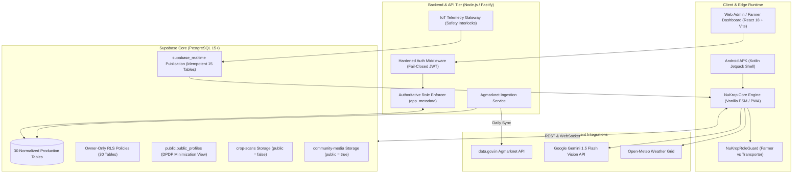

# NuKropAI Agrarian OS — Architecture & System Design

**Version:** 7.0 (Hardened Production Release)  
**Target:** Android Native Shell, Vite Web Dashboard, Supabase Backend, Fastify API Engine, Gemini Vision Cloud  

---

## 1. System Topology & Data Flow

---

## 2. Core Security & Privacy Architecture

### A. Authentication & Authoritative Role Architecture
* **Fail-Closed JWT Verification:** `backend/src/middleware/auth.ts` verifies incoming Bearer tokens using `HS256`, explicit audience matching (`authenticated`), and requires environment-configured secrets.
* **Privilege Escalation Defense:** Client-controlled `user_metadata` cannot grant elevated permissions. Only server-verified claims (`app_metadata.role` or `service_role`) assign administrative privileges. Public self-registration for `admin` is blocked.
* **Role Boundary Enforcement:** `NuKropRoleGuard` prevents simultaneous or conflicting cross-registration using identical contact details between farmers and transport operators.

### B. DPDP Act 2023 Compliant Data Projection
* In accordance with India's Digital Personal Data Protection Act 2023:
  * Private user details (`phone`, `email`, `land_acres`, `kcc_balance`, `agristack_id`, `biometric_lock`, `village`) are isolated on `public.profiles` under `profiles_select_own` RLS policy (`auth.uid() = id`).
  * `public.public_profiles` view exposes only non-sensitive public metadata (`id`, `farmer_id`, `full_name`, `avatar_url`, `district`, `state`, `role`, `agristack_verified`, `preferred_language`, `created_at`).
  * Direct writes (`INSERT, UPDATE, DELETE`) to `public.public_profiles` are explicitly revoked.

### C. Community RLS Security Model
* **Community Stories:** Ephemeral 24-hour stories (`public.community_stories`) enforce unexpired visibility (`expires_at > now()`) with zero `OR true` bypasses. Insertion and deletion require authenticated identity matching (`auth.uid() = user_id`).
* **Posts, Comments, Likes, and Follows:** Strict ownership checks prevent impersonation, unauthorized updates, or forged likes/follows.

### D. Safe, Idempotent Database Migrations
* **Realtime Publication Registration:** Evaluates `pg_publication_tables` before invoking `ALTER PUBLICATION`, trapping only `duplicate_object` and eliminating error `42710`.
* **Zero Destructive Data Cleanup:** Financial transaction records (`public.khata_transactions`) are never set to `NULL`. Missing user accounts are created as safe profile stubs to maintain audit history.
* **Safe Column Alteration:** Column casts inspect `information_schema.columns` to skip unnecessary casts when columns are already of type `text`.
