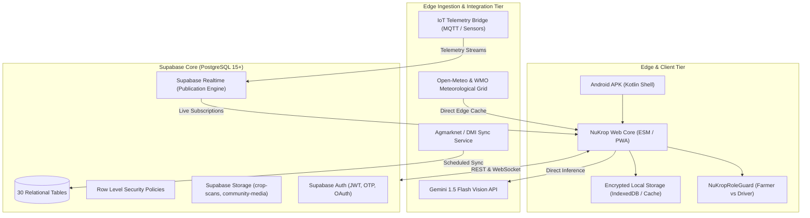

# NuKropAI Agrarian OS — Architecture & System Design

**Version:** 7.0 (Production Release)  
**Target:** Android, Web Dashboard, Supabase Backend, AI Diagnostic Cloud  

---

## 1. High-Level System Architecture

NuKropAI operates as a resilient, offline-first agrarian operating system designed for deployment in low-bandwidth rural environments across India. The ecosystem couples an edge-based Progressive Web Application running within an Android native web shell to a resilient PostgreSQL backend managed by Supabase, integrated with satellite weather observation networks, government mandi price grids, and Gemini Vision AI engines.

---

## 2. Core Subsystems

### A. Authentication & Identity Boundary
* **Multi-Role Segregation:** Farmers and Transporters operate under separate logical profiles in `public.profiles`. The `NuKropRoleGuard` prevents simultaneous or conflicting cross-registration using identical contact details.
* **DPDP Compliance:** In accordance with the Digital Personal Data Protection Act 2023, data minimization principles are strictly applied:
  * Private tables (`profiles`, `soil_health_cards`, `disease_scans`, `land_parcels`) protect personal and financial details.
  * `public.public_profiles` view exposes only anonymized farmer names, district identifiers, and avatar URLs.

### B. Mandi Price Ingestion & Intelligence
* Mandi market intelligence connects to the official Agmarknet / Directorate of Marketing & Inspection (DMI) pipeline.
* Rates are ingested into `public.mandi_live_rates` and partitioned by state, district, and commodity.
* Zero client-side price fabrication or synthetic fluctuations are permitted.

### C. Gemini 1.5 Flash Vision Diagnostic Pipeline
* Edge image capture passes inline base64 image data directly to Google Gemini Vision.
* Agricultural diagnostics categorize disease pathogen, severity rating, ICAR-approved bio-remedies, and scientific chemical interventions.
* Scans are stored in `public.disease_scans` and linked to the authenticated user ID.

### D. GramHaul Transport & Fleet Logistics
* Real-time freight discovery connects local crop producers with rural logistics operators.
* `public.truck_listings`, `public.haul_bookings`, and `public.driver_locations` update live via Supabase Realtime publications.
* Haul calculations utilize genuine geo-distance coordinates and standard per-kilometer tonnage tariffs.

### E. Database Layer & Idempotent Publication Architecture
* Normalized schema across 30 tables with foreign key cascades and audit triggers.
* Publications for real-time streaming are managed idempotently through catalog inspection (`pg_publication_tables`), eliminating PostgreSQL error `42710`.

